# TPI Virtualización

Trabajo Práctico Integrador de **Arquitectura y Sistemas Operativos**
Tecnicatura Universitaria en Programación a Distancia (UTN)

## Autor

- Camilo Angeleri - Ceangeleri8@gmail.com

## Descripción del proyecto

Este proyecto documenta, paso a paso, el proceso de **virtualización** con **Oracle VirtualBox**, instalando una máquina virtual con **Ubuntu Server** sobre un equipo anfitrión con Windows.

## Herramientas utilizadas

| Herramienta | Versión | Uso |
|---|---|---|
| Oracle VirtualBox | 7.2.2 | Hipervisor tipo 2 para crear la VM |
| Ubuntu Server | 26.04.1 LTS | Sistema operativo invitado (guest) |

## Estructura del repositorio

```
TrabajoIntegrador-Virtualizacion/
├── README.md
└── capturas-virtualbox/   # capturas de la creación y configuración de la VM
```

## Desarrollo paso a paso

### Paso 1: Preparación del entorno

En el equipo anfitrión ya está instalado **Oracle VirtualBox**, en su versión 7.2.2:

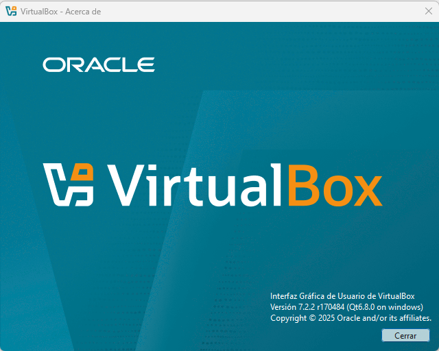

Luego se descargó la imagen ISO oficial de **Ubuntu Server 26.04.1 LTS** desde ubuntu.com/download/server, para arquitectura Intel o AMD de 64 bits (unos 3 GB):

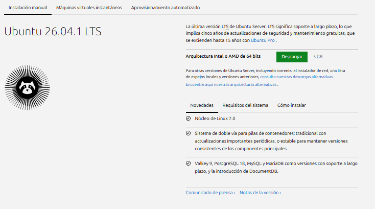

### Paso 2: Creación de la máquina virtual

En VirtualBox se creó una nueva máquina virtual llamada **Ubuntu-Server-AySO**, usando la ISO de Ubuntu Server descargada en el paso anterior. VirtualBox detecta automáticamente el tipo de sistema (Linux, Ubuntu de 64 bits). Se desmarcó la opción de instalación desatendida, para poder realizar y documentar la instalación manualmente en un paso posterior.

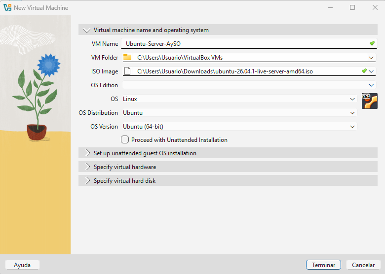

Se asignaron a la máquina virtual los siguientes recursos:

| Parámetro | Valor |
|---|---|
| Memoria RAM | 2048 MB |
| Procesadores | 2 |
| Disco virtual | 20 GB (VDI, de tamaño dinámico) |

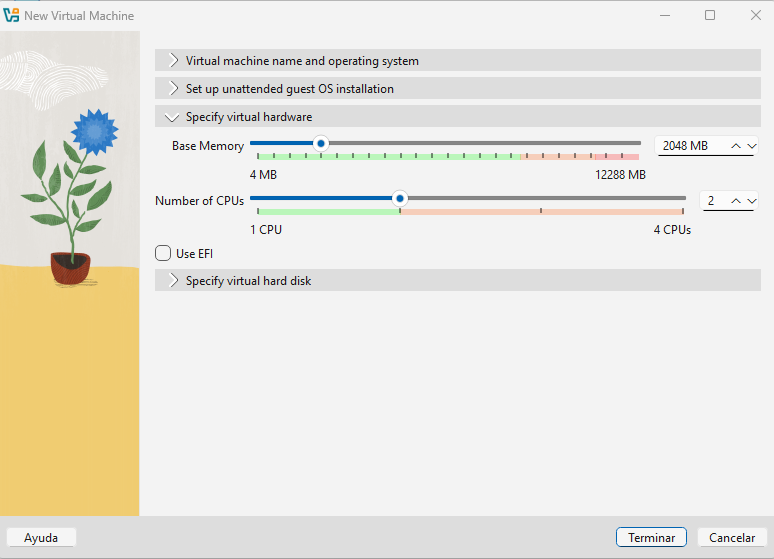

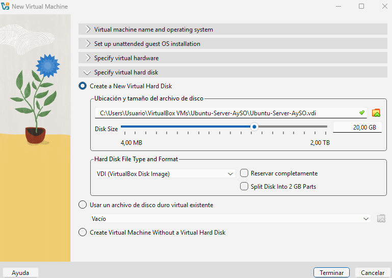

El disco es de tamaño dinámico, por lo que el archivo `.vdi` solo ocupa en el equipo anfitrión el espacio que el sistema invitado utiliza realmente.

### Paso 3: Configuración de la red en modo Bridge

Antes de iniciar la máquina virtual se cambió el modo de red del **Adaptador 1**. Por defecto VirtualBox usa **NAT**, pero para poder acceder al servidor desde otra máquina se configuró como **Adaptador puente (Bridge)**, de modo que la VM se conecta directamente a la red local y obtiene su propia dirección IP del router.

Como placa de red del equipo anfitrión se eligió la inalámbrica (*Intel(R) Wireless-AC 9560 160MHz*), que es la que se usa para conectarse a Internet.

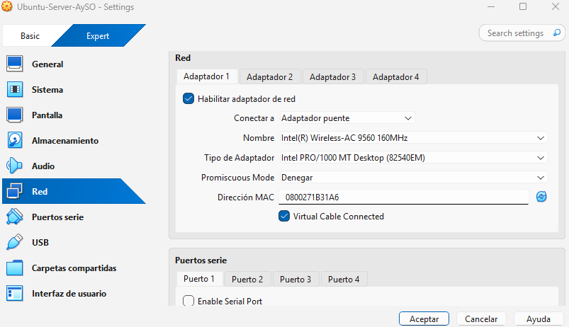

### Paso 4: Instalación de Ubuntu Server

Se inició la máquina virtual, que arrancó desde la ISO y abrió el instalador de Ubuntu Server en modo texto.

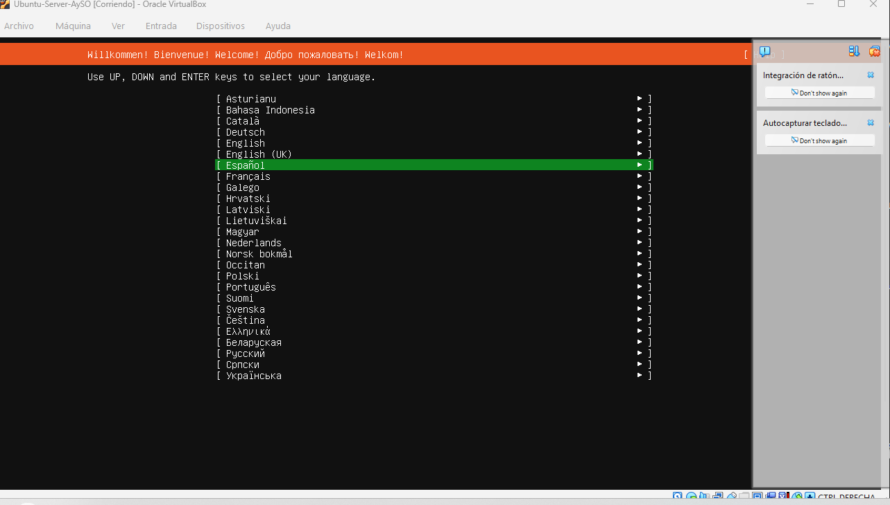

Se eligió la instalación estándar de **Ubuntu Server**, sin entorno gráfico:

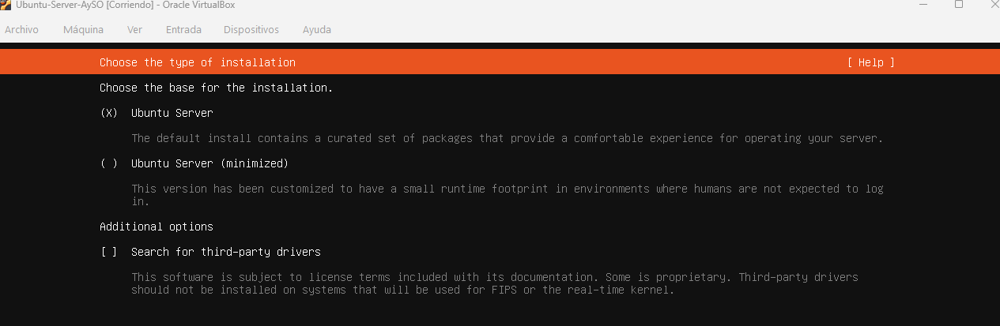

En la configuración de red, el instalador detectó la interfaz `enp0s3` y obtuvo por DHCP una dirección IP de la red local, lo que confirma que el modo Bridge funciona:

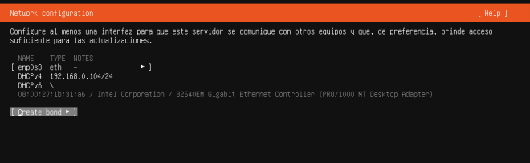

Para el almacenamiento se usó el disco completo de 20 GB, con LVM y sin cifrado:

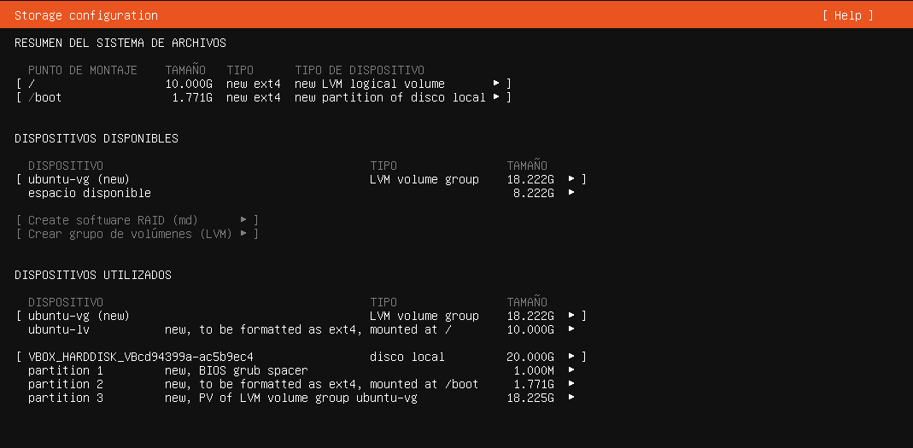

La descarga de actualizaciones de la etapa final de la instalación no pudo completarse por la conexión, por lo que se aplican más adelante desde el sistema ya instalado. Después de la instalación se configuró el orden de arranque de la VM para que inicie desde el disco duro, y se inició sesión con el usuario creado:

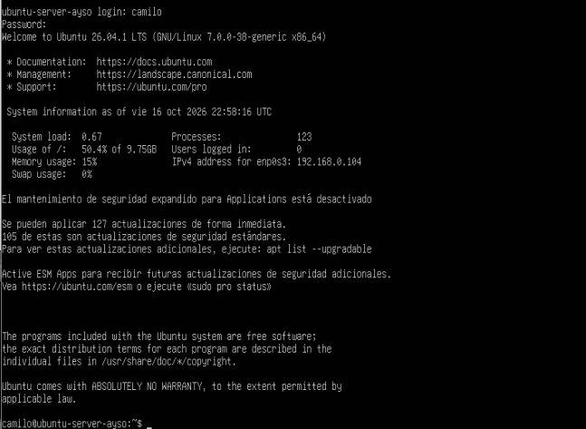

### Paso 5: Verificación de la conexión y actualización de la lista de paquetes

Ya dentro del sistema, se ejecutaron los siguientes comandos:

```bash
sudo dpkg --configure -a
sudo apt update
```

El primero termina cualquier configuración de paquetes que haya quedado pendiente, y no mostró cambios. El segundo descargó la lista de paquetes desde los repositorios oficiales de Ubuntu, lo que confirma que la máquina virtual tiene acceso a Internet a través de la red en modo Bridge. El aviso sobre el repositorio `file:/cdrom` corresponde a la imagen ISO de instalación, que ya no está montada, y no afecta el funcionamiento.

