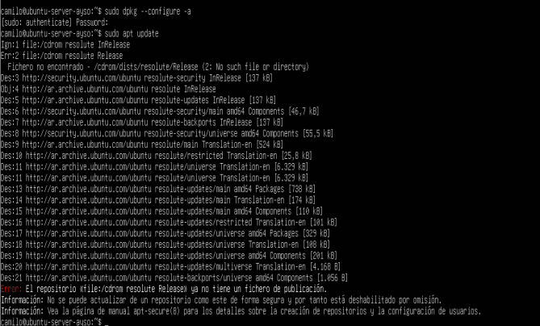
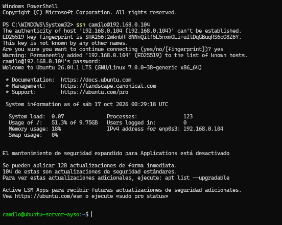
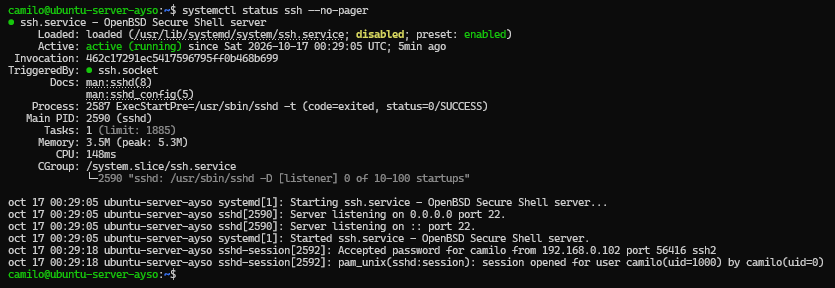
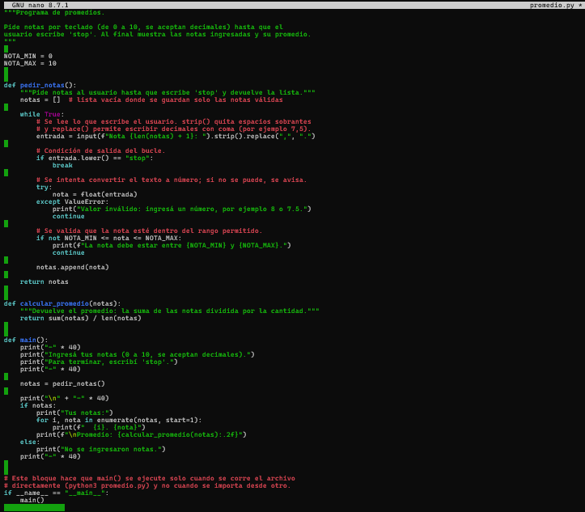
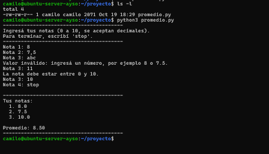
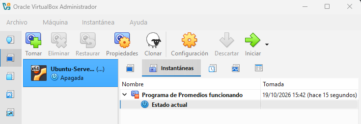

# TPI Virtualización

Trabajo Práctico Integrador de **Arquitectura y Sistemas Operativos**
Tecnicatura Universitaria en Programación a Distancia (UTN)

## Autor

- Camilo Angeleri - Ceangeleri8@gmail.com

## Descripción del proyecto

Este proyecto documenta, paso a paso, el proceso de **virtualización** con **Oracle VirtualBox**: se instala una máquina virtual con **Ubuntu Server** sobre un equipo anfitrión con Windows, se configura su red en modo Bridge y se accede a ella por SSH. Dentro de la máquina virtual se crea y ejecuta un programa en **Python** que calcula el promedio de una lista de notas.

## Objetivo del trabajo

- Configurar VirtualBox como base del entorno de trabajo.
- Instalar Linux (Ubuntu Server) en un entorno virtual.
- Ejecutar una aplicación en Python que calcule promedios.
- Documentar el proceso con capturas de pantalla, un informe técnico y este repositorio.

## Herramientas utilizadas

| Herramienta | Versión | Uso |
|---|---|---|
| Oracle VirtualBox | 7.2.2 | Hipervisor tipo 2 para crear la VM |
| Ubuntu Server | 26.04.1 LTS | Sistema operativo invitado (guest) |
| Python | 3.14.4 | Lenguaje del programa de promedios |
| OpenSSH server | Paquete de Ubuntu | Acceso remoto a la VM desde Windows |
| nano | 8.7.1 | Editor de texto en la terminal |
| Windows PowerShell | - | Cliente SSH en el equipo anfitrión |
| Git, GitHub y GitHub Desktop | - | Control de versiones y publicación del trabajo |

## Estructura del repositorio

```
TrabajoIntegrador-Virtualizacion/
├── README.md
├── capturas-virtualbox/   # capturas de VirtualBox: versión, ISO, creación de la VM, red y snapshot
├── capturas-ubuntu/       # capturas dentro de Ubuntu Server: instalación, Python, SSH y programa
├── codigo/
│   └── promedio.py        # programa de promedios
└── documento/
    └── TPI-Virtualizacion.pdf   # informe técnico
```

## Desarrollo paso a paso

### Paso 1: Preparación del entorno

En el equipo anfitrión ya está instalado **Oracle VirtualBox**, en su versión 7.2.2:


Luego se descargó la imagen ISO oficial de **Ubuntu Server 26.04.1 LTS** desde ubuntu.com/download/server, para arquitectura Intel o AMD de 64 bits (unos 3 GB):


### Paso 2: Creación de la máquina virtual

En VirtualBox se creó una nueva máquina virtual llamada **Ubuntu-Server-AySO**, usando la ISO de Ubuntu Server descargada en el paso anterior. VirtualBox detecta automáticamente el tipo de sistema (Linux, Ubuntu de 64 bits). Se desmarcó la opción de instalación desatendida, para poder realizar y documentar la instalación manualmente en un paso posterior.


Se asignaron a la máquina virtual los siguientes recursos:

| Parámetro | Valor |
|---|---|
| Memoria RAM | 2048 MB |
| Procesadores | 2 |
| Disco virtual | 20 GB (VDI, de tamaño dinámico) |


El disco es de tamaño dinámico, por lo que el archivo `.vdi` solo ocupa en el equipo anfitrión el espacio que el sistema invitado utiliza realmente.

### Paso 3: Configuración de la red en modo Bridge

Antes de iniciar la máquina virtual se cambió el modo de red del **Adaptador 1**. Por defecto VirtualBox usa **NAT**, pero para poder acceder al servidor desde otra máquina se configuró como **Adaptador puente (Bridge)**, de modo que la VM se conecta directamente a la red local y obtiene su propia dirección IP del router.

Como placa de red del equipo anfitrión se eligió la inalámbrica (*Intel(R) Wireless-AC 9560 160MHz*), que es la que se usa para conectarse a Internet.


### Paso 4: Instalación de Ubuntu Server

Se inició la máquina virtual, que arrancó desde la ISO y abrió el instalador de Ubuntu Server en modo texto.


Se eligió la instalación estándar de **Ubuntu Server**, sin entorno gráfico:


En la configuración de red, el instalador detectó la interfaz `enp0s3` y obtuvo por DHCP una dirección IP de la red local, lo que confirma que el modo Bridge funciona:


Para el almacenamiento se usó el disco completo de 20 GB, con LVM y sin cifrado:


La descarga de actualizaciones de la etapa final de la instalación no pudo completarse por la conexión, por lo que se aplican más adelante desde el sistema ya instalado. Después de la instalación se configuró el orden de arranque de la VM para que inicie desde el disco duro, y se inició sesión con el usuario creado:


### Paso 5: Verificación de la conexión y actualización de la lista de paquetes

Ya dentro del sistema, se ejecutaron los siguientes comandos:

```bash
sudo dpkg --configure -a
sudo apt update
```

El primero termina cualquier configuración de paquetes que haya quedado pendiente, y no mostró cambios. El segundo descargó la lista de paquetes desde los repositorios oficiales de Ubuntu, lo que confirma que la máquina virtual tiene acceso a Internet a través de la red en modo Bridge. El aviso sobre el repositorio `file:/cdrom` corresponde a la imagen ISO de instalación, que ya no está montada, y no afecta el funcionamiento.



### Paso 6: Verificación de Python

Se comprobó la versión de Python instalada en la máquina virtual. Ubuntu Server incluye Python 3 por defecto, por lo que no fue necesario instalarlo:

```bash
python3 --version
```

El resultado fue **Python 3.14.4**.


### Paso 7: Acceso remoto a la VM por SSH

Se instaló el servidor OpenSSH en la máquina virtual para poder trabajar con ella desde Windows, por ejemplo, para copiar y pegar el código del programa:

```bash
sudo apt install -y openssh-server
```

Como la VM está en modo Bridge, tiene su propia dirección IP en la red local (`192.168.0.104`), y desde PowerShell en el equipo anfitrión se conecta con:

```powershell
ssh camilo@192.168.0.104
```



En Ubuntu el servicio `ssh` se activa mediante un socket, por lo que arranca con la primera conexión. Con la sesión abierta, el estado del servicio es **active (running)**, y el registro muestra la conexión aceptada desde la IP del equipo anfitrión (`192.168.0.102`), distinta de la de la VM:



### Paso 8: Creación y ejecución del programa de promedios

Dentro de la máquina virtual se creó una carpeta de trabajo y, con el editor `nano`, el archivo `promedio.py`. El código se copió desde el equipo anfitrión y se pegó en el editor a través de la sesión SSH:

```bash
mkdir -p ~/proyecto
cd ~/proyecto
nano promedio.py
```

El programa pide notas por teclado hasta que se escribe `stop`. Acepta notas de 0 a 10, con decimales (con punto o con coma), rechaza texto y valores fuera de rango, y al final muestra las notas ingresadas y su promedio con dos decimales. El código está comentado y se encuentra en [`codigo/promedio.py`](codigo/promedio.py).



Para probarlo se ejecutó con `python3 promedio.py` y se ingresaron las notas `8`, `7,5` y `10`, además de dos entradas inválidas (`abc` y `11`) para comprobar las validaciones. El programa rechazó ambas y, al escribir `stop`, calculó el promedio correcto: **8.50**.

```bash
python3 promedio.py
```



### Paso 9: Instantánea (snapshot) de la máquina virtual

Con la máquina virtual apagada y el programa de promedios funcionando, se tomó una instantánea desde la pestaña **Instantáneas** de VirtualBox, con el nombre *Programa de Promedios funcionando*. Una instantánea guarda el estado completo de la VM (disco y configuración) en ese momento, de modo que si más adelante algo falla se puede volver a este punto sin reinstalar nada.



## Resultados obtenidos

- Se creó una máquina virtual funcional con Ubuntu Server 26.04.1 LTS, con 2 GB de RAM, 2 procesadores y 20 GB de disco.
- La red en modo Bridge le asignó a la VM una IP propia de la red local (`192.168.0.104`), distinta de la del equipo anfitrión (`192.168.0.102`), y permitió acceder a ella por SSH desde Windows.
- Python 3.14.4 ya estaba disponible en el sistema. El programa de promedios se creó y se ejecutó correctamente, con validación de las entradas: con las notas 8, 7,5 y 10 devolvió el promedio esperado, 8.50.
- Se tomó una instantánea de la máquina virtual con el trabajo terminado.

## Conclusiones

### Aprendizaje

- Cómo funciona un hipervisor de tipo 2 y cómo se crea y configura una máquina virtual (ISO, recursos, disco y red).
- La diferencia entre los modos de red NAT y Bridge, y por qué con Bridge la VM es visible desde la red local.
- Cómo trabajar con un sistema sin entorno gráfico: terminal, `apt`, `nano`, `systemctl` y SSH.
- Que Ubuntu Server ya incluye Python 3 y que el comando es `python3` (`python` no existe por defecto).

### Dificultades

- **La instalación se interrumpió en la etapa final.** El instalador falló en dos intentos durante la descarga de actualizaciones, probablemente por una conexión Wi-Fi inestable, aunque el sistema base ya estaba instalado. Después, la VM quedó mucho tiempo en el reinicio. Se resolvió apagándola y configurando el orden de arranque con el disco duro primero, y el sistema inició correctamente.
- **Dirección IP dinámica.** El router asigna la IP por DHCP y cambió entre una instalación y otra (`192.168.0.106` y `192.168.0.104`), por lo que hay que confirmarla con `ip -4 addr` antes de conectarse.
- **SSH por activación de socket.** Recién instalado, `ssh.service` figuraba como `inactive (dead)`. Es el comportamiento normal de Ubuntu, que lo inicia con la primera conexión mediante `ssh.socket`.
- **Aviso en `apt update`.** Mostró un error por el repositorio `file:/cdrom`, que corresponde a la ISO de instalación ya desmontada, sin afectar el funcionamiento.

### Beneficios

- Entorno aislado: se instala y prueba un sistema completo sin modificar el equipo físico.
- Las instantáneas permiten volver a un estado anterior sin reinstalar.
- Con la red Bridge, la VM se comporta como un equipo más de la red, útil para practicar administración remota.
- No requiere hardware adicional.

### Mejoras

- Aplicar las actualizaciones de seguridad pendientes (`apt upgrade`) cuando la conexión sea estable.
- Asignar una IP fija, o una reserva en el router, para que la VM no cambie de dirección.
- Usar autenticación SSH con clave pública en lugar de contraseña.
- Mejorar el programa de promedios: guardar las notas en un archivo, calcular promedios ponderados o cargar las notas desde un archivo.

## Video explicativo

_(agregar el link al video)_

## Bibliografía

- Rigoni, C. (2026). *Unidad 7: Virtualización*. Material de cátedra, Arquitectura y Sistemas Operativos, Tecnicatura Universitaria en Programación a Distancia, UTN (PDF del campus virtual).
- Rigoni, C. (2026). *Virtualización de recursos por un hipervisor Tipo 2*. Material de cátedra, Arquitectura y Sistemas Operativos, Tecnicatura Universitaria en Programación a Distancia, UTN (PDF del campus virtual).
- Cátedra de Arquitectura y Sistemas Operativos (2026). *Virtualización BIOS/UEFI*. Material de cátedra, Tecnicatura Universitaria en Programación a Distancia, UTN (PDF del campus virtual).
